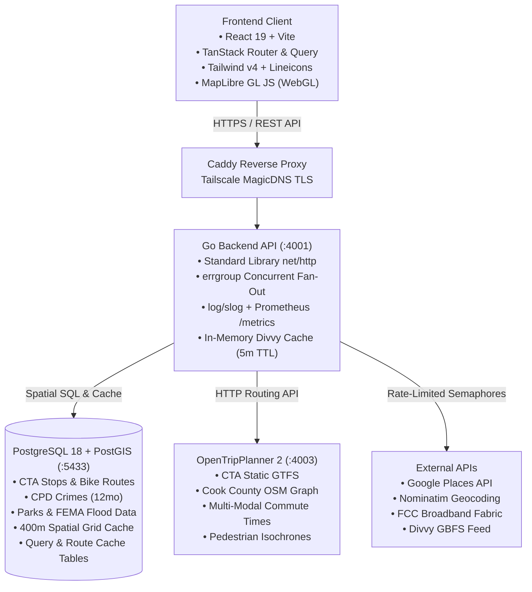

# BlockFactor

> **Hyper-local location intelligence and rental property scoring for car-free and transit-oriented urban living in Chicago, IL.**

---

## Overview

BlockFactor is an analytical location-intelligence platform engineered to evaluate, score, and rank residential properties (0–100) for transit-reliant renters and urban commuters. It calculates objective composite scores across 8 environmental, logistical, and safety factors:

1. **Transit Proximity & Reliability:** CTA 'L' rapid transit and high-frequency bus corridors.
2. **Supermarket & Grocery Access:** Walking distance to full-scale supermarkets and daily essentials.
3. **Third Places:** Density of independent cafes, coworking spaces, and fitness studios.
4. **Green Space & Trails:** Proximity to public parks, the Lakefront Trail, and the 606 / Bloomingdale Trail.
5. **Acoustic Comfort:** Buffer distances from elevated CTA tracks, expressways, and high-volume arterials.
6. **Public Safety:** Normalized 12-month crime density percentiles from the Chicago Data Portal.
7. **Flood Risk:** FEMA hazard zones and 311 basement/sewer backup incident history.
8. **Solar Exposure:** Deterministic natural light calculations based on unit window orientation and floor level.

---

## Project Documentation

| Document | Description |
|---|---|
| **[Product Requirements Document (PRD)](docs/PRD.md)** | Product vision, persona definitions, scoring formulas, data sources, and native monetization catalog. |
| **[Technical Architecture Specification](docs/ARCHITECTURE.md)** | Full technical architecture: Go backend, PostGIS spatial database, self-contained caching, OTP2 routing, WebGL frontend, and server environment profile. |
| **[Implementation Phases & Roadmap](docs/IMPLEMENTATION_PHASES.md)** | Step-by-step engineering roadmap (Phases 1–7) with deliverables and validation criteria. |
| **[Third-Party Requirements & Guardrails](docs/THIRD_PARTY_REQUIREMENTS.md)** | Compliance guidelines, rate limits, caching rules (Google Places 30-day TTL, OSM Nominatim policies). |
| **[Agent Guidelines & Working Agreements](AGENTS.md)** | Pair programming standards, permission gates, idiomatic Go standards, and anti-vibe-coding UI rules. |
| **[Open Data Attribution](ATTRIBUTION.md)** | OpenStreetMap, CTA, City of Chicago, FEMA, and FCC data attribution notices. |
| **[License](LICENSE)** | Proprietary / Closed-Source License. |

---

## Tech Stack



---

## Monorepo Layout

```text
blockfactor/
├── docs/                        # Architecture specs, PRD, and implementation roadmap
│   ├── PRD.md
│   ├── ARCHITECTURE.md
│   └── IMPLEMENTATION_PHASES.md
├── services/
│   ├── api/                     # Go Backend Application (net/http, scoring, spatial)
│   │   ├── cmd/
│   │   │   ├── server/          # HTTP API entry point
│   │   │   └── seed/            # Open dataset ingestion CLI
│   │   └── internal/            # Domain packages (api, scoring, spatial, clients, cache)
│   └── otp/                     # OpenTripPlanner 2 Docker context & graph build scripts
├── packages/
│   └── web/                     # React 19 + Vite + TanStack Frontend
│       └── src/
│           ├── routes/          # TanStack Router definitions
│           ├── components/      # UI components, cards, slider trays, comparison dock
│           ├── map/             # MapLibre GL JS layers & isochrones
│           └── hooks/           # TanStack Query data hooks
├── db/
│   └── migrations/              # Goose SQL migrations for PostGIS
├── AGENTS.md                    # Pair programming agreements & code standards
├── docker-compose.yml           # Unified Docker Compose with OTP2 profiles
└── Makefile                     # Universal developer tasks and CI targets
```
