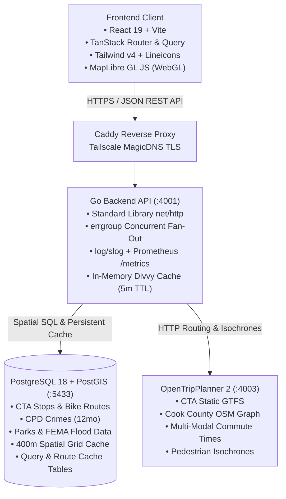
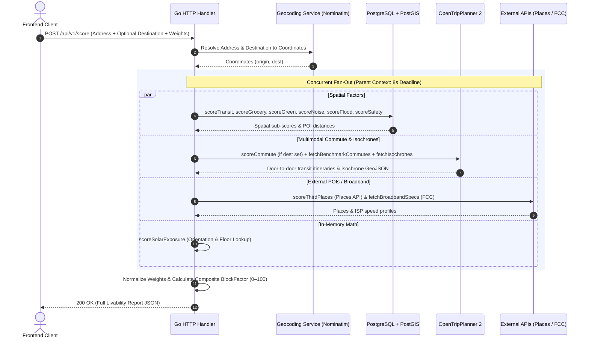

# BlockFactor: Architecture & Technical Specification

**Version:** 0.1 (In Progress — being designed collaboratively)
**Status:** Draft
**See also:** [PRD.md](./PRD.md) for product requirements and scoring logic.

---

## 1. Deployment Phases

### Phase 1 — Home Server (Current / Development)

BlockFactor is initially self-hosted on a personal home server for active development and personal use. The developer is the first real user with a concrete deadline: **evaluating Chicago neighborhoods ahead of a move from Pilsen, targeting May 2027.**

**Host Hardware:**
- **Device:** Beelink SEi12 Mini PC
- **OS:** Ubuntu 22.04.5 LTS (Jammy Jellyfish)
- **CPU:** Intel Core i7-12650H (10 cores / 16 threads, up to 4.7 GHz)
- **RAM:** 32 GB total — ~24 GB currently free across co-located services
- **Co-located Services:** Plex, Arr stack (Sonarr, Radarr, Bazarr), Usenet clients, Home Assistant, n8n, monitoring stack (Prometheus, Grafana, Loki)

**Dedicated Storage for BlockFactor:**
- A dedicated **M.2 NVMe SSD in a Sabrent USB-C enclosure** is provisioned as a dedicated mount for BlockFactor's persistent data volumes: PostGIS data, OTP2 graph files, and OSM extracts.
- Rationale: `/media/disk1` (main array, 704GB free) and `/media/disk2` (17TB array, critically full at 100%) are co-located with media. A dedicated SSD avoids I/O contention and keeps BlockFactor's data isolated and easy to manage.
- **Status (provisioned 2026-08-22):** Partitioned as GPT with a single partition, formatted `ext4` (label `external-ssd-enc` — truncated from `external-ssd-enclosure` due to ext4's 16-character label limit), and mounted at `/mnt/external-ssd-enclosure` (476.9 GB, owned by the `kingsley-swizzin` user). Persisted across reboots via a UUID-based `/etc/fstab` entry (`defaults,noatime`).
- ⚠️ Actual capacity is **512 GB-class (476.9 GB usable)**, smaller than the ~1TB originally estimated — worth keeping in mind for OSM extract + PostGIS + OTP2 graph capacity planning.

**Key Constraints:**
- OTP2 JVM heap capped at ~5 GB to avoid starving co-located services.
- Aggressive caching is a **first-class requirement**, not a future optimization.
- All services run under Docker Compose — no Kubernetes overhead.
- Development environment only. No production hardening required yet.

**CI/CD:**
- GitHub-hosted runners from day one (see §13.1) — zero setup while the project structure is still churning through Phases 1-6, and CI availability isn't tied to the home server's uptime while actively iterating.
- Migrates to a self-hosted runner on the home server in Phase 7, once the app is actually deployed there and self-hosting has a clear payoff.

---

### Phase 2 — Cloud Deployment (Post-Polish / Monetization)

> This is a *deployment* phase, numbered independently from `IMPLEMENTATION_PHASES.md`'s numbered build phases — this deployment target is implemented by that document's **Phase 8: Production Release**, not its own "Phase 2."

Once the application reaches a quality threshold validated through personal use, BlockFactor migrates to cloud infrastructure with monetization activated.

**Target Stack:** Hetzner (compute) + Cloudflare (CDN / DNS / Tunnels)
- Hetzner CX/CAX VMs (~$8–15/month) offer substantially better price/performance than AWS EC2.
- Cloudflare free tier covers DNS, CDN, and DDoS protection. Cloudflare Tunnels can bridge Phase 1's home server to the public internet without port forwarding.
- AWS remains an option for specific managed services (e.g., RDS) but is not the primary compute target.
- **Public-launch hardening (required before monetization):** rate limiting / abuse protection on the scoring endpoint (protects Google Places quota and affiliate CPA integrity), CORS lockdown to the public origin, and basic bot filtering at the Cloudflare edge.

**CI/CD:**
- Same GitHub Actions pipelines, retargeted to Hetzner via SSH deploy or container registry push.
- Explore Dagger for pipeline portability as a learning opportunity.

---

## 2. Home Server Environment Profile

> Captured via automated server inventory on 2026-08-21. Informs integration decisions.

### 2.1 Reverse Proxy

- **Caddy** is the sole active reverse proxy (`/etc/caddy/Caddyfile`), running since boot.
- Nginx is installed but inactive. Traefik is not present.
- TLS is handled automatically by **Tailscale MagicDNS** — Caddy provisions certs for `*.han-puffin.ts.net` with zero manual management.
- Primary local access domain: `kingsley-home-server.han-puffin.ts.net`
- **Integration pattern for BlockFactor:** Add a `handle_path /blockfactor/*` block in the Caddyfile (or a dedicated port-based virtual host), proxying to `localhost:<port>`. This is the existing pattern for all services.

### 2.2 Existing Infrastructure BlockFactor Can Leverage

| Resource | Location | Relevance |
|---|---|---|
| **Redis** | `localhost:6379` (host-level) | Available for short-TTL in-memory caching (Divvy GBFS, OTP2 results). No sidecar needed. |
| **PostgreSQL 15** | Internal (Mealie) | Do NOT share — spin a dedicated PostGIS container. |
| **PostgreSQL 16** | Internal (n8n) | Do NOT share — spin a dedicated PostGIS container. |
| **Portainer** | `:9443` | Docker management UI — BlockFactor can be managed here or via standalone Compose. |

### 2.3 Port Allocation

Ports in the 4000–4999 range are unoccupied and reserved for BlockFactor services:

| Service | Host Port |
|---|---|
| Go API | `4001` |
| Frontend (Vite dev server) | `4002` |
| OTP2 | `4003` |
| PostgreSQL + PostGIS | `5433` (avoids conflict with host-level `:5432`) |

### 2.4 Compose Project Location

Following the existing manual compose pattern (e.g., `strava-stats`, `readmeabook`):
```
/home/kingsley-swizzin/blockfactor/
├── docker-compose.yml
├── .env
└── data/               # symlink or bind mount → /mnt/external-ssd-enclosure
```

---

## 3. High-Level System Topology



---

## 4. Backend Architecture & Request Orchestration

### 4.1 Core Language & Contracts
* **Language:** **Go**
  * High-performance compiled binary with minimal memory footprint on shared home server hardware.
  * Native goroutine scheduling and channel primitives for concurrent I/O fan-out.
* **Type Contracts:** **OpenAPI 3.1 / REST**
  * Single source-of-truth API specification.
  * Generates strict types for Go backend (`oapi-codegen`) and TypeScript frontend (`openapi-typescript`).
  * Avoids gRPC gateway complexity while maintaining end-to-end type safety.

### 4.2 Concurrency & Pipeline Lifecycle (`errgroup`)
Rather than a generic worker pool, address evaluation uses structured concurrency with Go's `golang.org/x/sync/errgroup`:



### 4.3 Geocoding Strategy
* **Phase 1 (Development):** Public Nominatim API (`nominatim.openstreetmap.org`) with structured query formatting for low-volume development testing.
  * **No typeahead against public Nominatim:** the public endpoint's usage policy explicitly prohibits autocomplete traffic. Phase 1 geocodes once on form submit; typeahead address search ships only once self-hosted Photon lands (Phase 2).
  * **Geocode once, score with coordinates:** `POST /api/v1/score` accepts pre-resolved coordinates from the prior geocode call. Re-geocoding origin + destination inside the score request — serialized at ≤ 1 req/sec — would burn ~2s of the 8s scoring budget.
* **Phase 2 (Production / Pre-Launch):**
  * **Self-Hosted Nominatim (PostGIS):** Ingests Illinois OSM extract for accurate, ToS-compliant address resolution and building polygon snapping.
  * **Photon (Elasticsearch/Lucene, Optional):** Lightweight search index (<2GB RAM) for low-latency (<20ms) typeahead address search in the UI input bar.

### 4.4 Idiomatic Go Package Layout
The Go backend follows a cohesive, domain-layered package structure that avoids fragmentation while maintaining testability:

```text
services/api/
├── cmd/
│   ├── server/main.go          # HTTP API entry point (net/http ServeMux wiring)
│   └── seed/main.go            # Open dataset ingestion CLI (CTA, CPD Crimes, Parks)
├── internal/
│   ├── api/                    # HTTP handlers, middleware, request validation
│   ├── scoring/                # Composite scoring orchestrator & factor math
│   │   ├── engine.go           # errgroup fan-out & weight normalization (9 or 10 factors)
│   │   ├── factor_transit.go   # S_transit calculation
│   │   ├── factor_commute.go   # S_commute point-to-point calculation (optional)
│   │   ├── factor_bike.go      # S_bike calculation (quality-tiered decay + directional network bonus)
│   │   ├── factor_grocery.go   # S_grocery calculation
│   │   ├── factor_third_places.go # S_third_place calculation
│   │   ├── factor_green.go     # S_green calculation
│   │   ├── factor_noise.go     # S_noise calculation
│   │   ├── factor_flood.go     # S_flood calculation
│   │   ├── factor_safety.go    # S_safety percentile calculation
│   │   └── factor_solar.go     # S_solar deterministic math
│   ├── spatial/                # PostGIS queries (ST_DWithin, GIST indexes, grid cells)
│   ├── clients/                # Outbound HTTP clients (Nominatim, OTP2, Places, FCC)
│   └── cache/                  # Postgres UNLOGGED cache + in-memory sync.Map
├── go.mod
└── go.sum
```

---

## 5. Spatial Database & Caching Architecture

### 5.1 Database Engine & Image
* **Engine:** **PostgreSQL 18 + PostGIS** extension.
* **Docker Context:** Runs as a dedicated container (`blockfactor-db`) isolated from any existing host database.
* **Volume Mount:** Local development uses named Docker volumes; the home server applies a `docker-compose.override.yml` that binds the dedicated NVMe SSD mount (`/mnt/external-ssd-enclosure/blockfactor/pgdata`).

### 5.2 Spatial Coordinate Standard & Types
* **Standard Representation:** `geography(Point, 4326)` (WGS84 GPS latitude and longitude).
* **Rationale:** Direct GPS compatibility; native meter-based radial queries (`ST_DWithin`) without reprojection overhead.

### 5.3 Spatial Indexing Strategy
* **Index Type:** `GIST` indexes on all location geometry columns (`cta_stops`, `cpd_crimes`, `parks`, `bike_routes`).
* **Performance:** Executes radial queries across 300k+ spatial records in < 5 ms.

### 5.4 Two-Tier Caching Architecture (100% Self-Contained)
To avoid dependencies on external host Redis instances, caching is partitioned across two self-contained tiers:

1. **In-Process Go Cache (Volatile Tier):**
   * Stored in-memory in Go (`sync.Map` / bounded LRU with TTL).
   * Used for high-frequency, ultra-short data: **Divvy GBFS dock & e-bike availability** (5-minute TTL).
2. **PostgreSQL Cache Tables (Persistent Tier — LOGGED):**
   * Stored in standard **LOGGED** tables (`cache_entries`) with an indexed `expires_at` column.
   * **Why LOGGED (Durability & Cost Math):** Cache writes occur only on cache misses — write volume is near-zero in Phase 1 and modest in Phase 2. `UNLOGGED` tables truncate on unclean restarts (power loss, JVM OOM-kill), introducing severe asymmetric risk: refilling the Google Places 400m grid costs actual money (~$35/1000 calls), and FCC reference data has a 6-month lifecycle. Standard WAL-logged tables protect against thundering-herd refill spikes on crash recovery with negligible write overhead. (If extreme write volume ever dictates, it is a one-line reversible migration: `ALTER TABLE cache_entries SET UNLOGGED`).
   * **Google Places 400m Grid Cache:** 30-day TTL.
   * **FCC Broadband Address Cache:** Bi-annual refresh.
   * **OTP2 Commute Route Durations:** 7-day TTL. Cache key: origin/destination coordinates snapped to a 100m grid + mode + departure window.
   * **Runtime vs. Ingestion Artifact Caching:** Runtime caches (Places, OTP2, FCC) store lightweight (< 10 KB) JSON records queried strictly by exact key. While `cache_entries` was also reused to cache large raw ingestion artifacts (e.g. the ~100MB CTA GTFS `.zip` archive, FEMA GeoJSON dumps) for fast local `make seed` runs and ephemeral container portability (DATA_SOURCES.md), storing 100MB+ binaries in `JSONB` causes base64 expansion and TOAST bloat. See §13.2 for the optimization plan.

### 5.5 Outbound API Protection & Cost Defense
To prevent runaway third-party API costs or thundering-herd spikes during cold cache refills, the Go backend enforces four defensive layers:

1. **Token-Bucket Rate Limiting (`golang.org/x/time/rate`):**
   * Per-client outbound rate limiters cap requests/sec to external services (Google Places, FCC, Public Nominatim) regardless of inbound traffic bursts.
2. **Daily Budget Circuit Breaker:**
   * Tracks daily outbound billable calls (via `blockfactor_external_api_calls_total`). If the configured daily quota threshold is reached, the breaker trips: outbound calls halt, and `S_third_place` gracefully returns `null` (triggering automatic weight renormalization).
3. **In-Flight Singleflight Deduplication (`golang.org/x/sync/singleflight`):**
   * Concurrent requests querying the same cold 400m grid cell or address execute exactly one upstream API call; all waiting goroutines share the resolved result.
4. **Provider-Side Hard Quotas & Billing Alerts:**
   * Hard monthly spending caps and budget alert webhooks configured directly within the Google Cloud Platform and external provider consoles.

---

## 6. Transit & Isochrone Engine (OpenTripPlanner 2.x)

### 6.1 Role & Capabilities
* **Engine:** OpenTripPlanner 2.x running in a dedicated Docker container (`blockfactor-otp`).
* **API Surface:** The Go client targets OTP2's **GTFS GraphQL API** exclusively — the legacy REST plan API was removed in OTP 2.x. Isochrones come from the travel-time API. Phase 3 client fixtures are GraphQL-shaped from day one so the Phase 6 integration is not a rewrite.
* **Inputs:**
  * CTA Static GTFS Schedule archive (`chicago-gtfs.zip`).
  * Cook County OpenStreetMap extract — the Geofabrik Illinois `.osm.pbf` cropped to a Cook County bounding box via `osmium extract` before graph build (smaller graph, faster build, lower heap).
* **Outputs:**
  * **Door-to-door transit commute durations** (walking + waiting + riding + transfers) to benchmark employment centers (The Loop, O'Hare, Midway, Fulton Market).
  * **Pedestrian & transit reach isochrone polygons** (e.g. 15-min and 30-min travel boundaries) streamed to MapLibre GL JS as GeoJSON.

### 6.2 Resource Controls & Persistence
* **JVM Heap Limit:** Strictly capped at `-Xmx5G` to prevent memory contention with co-located media and automation stacks. Note: graph *builds* are more memory-hungry than serving — building from the Cook County crop (rather than full Illinois) keeps the one-time build inside the same cap.
* **Graph Persistence:** The graph is pre-compiled once (`otp --build data/`) and saved as `graph.obj` on the dedicated NVMe SSD (`/mnt/external-ssd-enclosure/blockfactor/otp-data/graph.obj`). On restarts, OTP2 boots in < 15 seconds by loading the pre-compiled graph directly into RAM.

---

## 7. Frontend Client & Visualization Architecture

### 7.1 Framework & Core Tooling
* **Build Tool & Framework:** **React 19 + Vite** (Single Page Application).
* **Routing:** **TanStack Router**
  * Strict type-safe route definitions.
  * **Search Param Serialization:** Address, unit orientation (e.g. facing, floor), and custom factor weights (0–100%) are continuously synchronized to the URL query string (`/report?address=...&w_transit=35&w_grocery=25&facing=S`).
  * Enables zero-friction link sharing and browser bookmarking that preserves exact report state.
  * **Comparison Dock State:** Pinned comparison addresses ride in a repeatable `compare` search param (`?address=...&compare=...&compare=...`, max 2 pins), validated by the same Router search schema.
* **Server State & Caching:** **TanStack Query**
  * Automatic request deduplication, background prefetching, and client-side caching.
* **OpenAPI Client:** Generated TypeScript API client (`openapi-typescript` + `openapi-fetch`) typed directly from backend OpenAPI specs.
* **Dev API Access:** The Vite dev server proxies `/api` → `http://localhost:4001`, eliminating CORS in development; CORS configuration applies only to deployed environments.

### 7.2 Component Library & Design System
To enforce an analytical, high-density tool aesthetic and avoid generic AI "vibe-coded" tropes:
* **Component Primitives:** **`shadcn/ui` (Radix UI)** copied directly into `packages/web/src/components/ui/` with custom, sharp design tokens.
* **Styling Engine:** **Tailwind CSS v4** with a strict design token scale:
  * **Geometry:** Sharp, disciplined border radii (`rounded-sm` / `rounded-md`—no bubbly pill shapes).
  * **Palette:** Neutral Slate/Zinc base (`#09090b` / `#fafafa`) with zero purple/violet radial gradients.
  * **Transit Branding:** Authentic CTA Line colors for station badges (Red `#c60c30`, Blue `#00a1de`, Brown `#62361b`, Green `#009b3a`, Pink `#e27ea6`, Orange `#f9461c`, Purple `#522398`, Yellow `#f9e300`).
  * **Score Indicators:** Emerald (≥ 85), Lime (70–84), Amber (50–69), Rose (< 50).
* **Iconography:** **Lineicons** (14–16px, 1.5px stroke). Strictly no Lucide over-use and zero emoji slop in headers/cards.
* **Typography:** **Inter / Geist** for body text; **Geist Mono** for all coordinates, distances (`0.28 mi`), commute times (`14 min`), and numeric scores.

### 7.3 Screen Layout & Workspace Architecture
The primary interface is a **Split-Screen Location Intelligence Workspace**:
* **Left Panel (Scored Analytics & Controls — Scrollable):**
  * **Composite Score Hero Card:** Radial score ring (0–100). (Neighborhood archetype descriptor deferred to v2 — derivation rules are not yet designed.)
  * **Weight Customization Drawer:** Reactive slider tray with dynamic normalization and preset chips matching the PRD personas (Remote Worker, Hybrid / In-Office Commuter).
  * **Factor Breakdown Accordions:** 9–10 dense metric cards (10 when a custom commute destination is set) with distance pills and sub-scores.
  * **Native Affiliate Drawer:** Contextually triggered cards (ISP broadband speed check, Lemonade quote, Dolly movers).
* **Right Panel (WebGL Map — Fixed / Full Bleed):**
  * Full-screen GPU-accelerated **MapLibre GL JS** canvas.
  * Layer toggles: CTA rail lines, protected bike corridors, parks, crime heat contours, and POI clusters.
  * Interactive 15-minute walk and 30-minute transit reach isochrone polygons.
* **Bottom Comparison Dock (Collapsible):**
  * Sticky drawer allowing users to pin and compare up to 3 addresses side-by-side.

### 7.4 Map Engine & WebGL Vector Rendering
* **Map Visualizer:** **MapLibre GL JS**
* **Vector Basemap Tiles:** CartoCDN / OpenFreeMap vector styles ($0 licensing fees, GPU accelerated).

### 7.5 Link Sharing & Social Previews (Phasing)
* **Phase 1 (Home Server / Personal Use):** Client-side URL state via TanStack Router allows immediate link sharing with identical visual configuration.
* **Phase 2 (Public Launch):** A lightweight Go route handler (`GET /share/:report_id`) injects dynamic OpenGraph meta cards (title, summary score, static preview map snapshot) for iMessage/Slack/Twitter previews. Delivered in `IMPLEMENTATION_PHASES.md`'s **Phase 8: Production Release**, alongside the cloud migration this deployment phase describes.

---

## 8. Database Migrations (`goose`)

### 8.1 Tooling & Workflow
* **Migration Engine:** **`goose`**
* **Migration Format:** Plain `.sql` files with standard `-- +goose Up` and `-- +goose Down` annotations located in `/db/migrations/`.
* **Execution Options:**
  * Standalone CLI for local schema management: `goose -dir db/migrations postgres "$DB_URL" up`.
  * Embedded migration runner: Can be embedded into the Go server binary via `goose.Up(db, "migrations")` to automatically migrate dev and CI databases on container startup.

---

## 9. Monorepo Orchestration & Developer Experience

### 9.1 Root `Makefile` Architecture
To ensure **100% parity between local development and GitHub Actions CI pipelines**, all high-level developer tasks and CI validation steps are driven via a root `Makefile`:

```makefile
.PHONY: dev build test lint migrate-up seed generate generate-check

# Start full local development stack (DB, OTP2, Go API with hot-reload, Vite)
dev:
	docker compose up -d db otp
	@echo "Starting Go API (Air) and Vite Frontend..."
	# runs concurrently via air and bun run dev

# Run all unit and integration tests
test:
	go test -v ./services/api/...
	cd packages/web && bun run test

# Run linters across Go and TypeScript
lint:
	golangci-lint run ./services/api/...
	cd packages/web && bun run lint

# Run database migrations
migrate-up:
	goose -dir db/migrations postgres "$$DATABASE_URL" up

# Ingest and seed Chicago base datasets
seed:
	go run ./services/api/cmd/seed/main.go

# Regenerate OpenAPI contracts and client SDKs
generate:
	oapi-codegen -config services/api/openapi.cfg.yaml docs/openapi.yaml
	cd packages/web && bun run generate-api

# Verify generated contracts are up-to-date (CI drift gate)
generate-check: generate
	git diff --exit-code
```

### 9.2 CI/CD Parity
* In GitHub Actions (self-hosted runner or GitHub-hosted), CI jobs simply invoke the Makefile targets (`make lint`, `make test`, `make generate-check`).
* Eliminates configuration drift between local developer machines and CI pipelines.

---

## 10. Observability & Monitoring Stack Integration

Because the home server already operates a production-grade monitoring stack (**Prometheus, Grafana, Loki, Promtail**), BlockFactor hooks directly into this infrastructure:

### 10.1 Structured Logging (`log/slog` → Promtail → Loki)
* Standard library **`log/slog`** with JSON formatting (`slog.NewJSONHandler(os.Stdout, ...)`).
* Structured fields: `trace_id`, `geohash` (truncated location), `duration_ms`, `factor`, `cache_hit`, `status`.
* **PII guardrail:** raw home/workplace addresses are never written to logs — only truncated geohashes. Addresses are the product's most sensitive input.
* Promtail scrapes container stdout logs directly into Loki for fast querying and debugging in Grafana dashboards.

### 10.2 Metrics Collection (`/metrics` → Prometheus)
* Exposes a standard **`/metrics`** endpoint in the Go backend using `prometheus/client_golang`.
* **Key Custom Metrics:**
  * `blockfactor_score_request_duration_seconds` (Histogram by status / cache tier — never labeled by address or address hash, which would create unbounded label cardinality)
  * `blockfactor_factor_duration_seconds` (Histogram partitioned by factor: `transit`, `grocery`, `safety`, `otp`, etc.)
  * `blockfactor_cache_hits_total` / `blockfactor_cache_misses_total` (Counter by cache domain: `places`, `otp`, `fcc`, `divvy`)
  * `blockfactor_external_api_calls_total` (Counter for Google Places and FCC API invocations to track quota consumption)

---

## 11. Data Ingestion Pipeline (`cmd/seed`)

### 11.1 Design & Execution Model
Open city datasets are ingested via a dedicated, standalone Go CLI tool (`services/api/cmd/seed/main.go`). This keeps the HTTP API server completely stateless and avoids resource contention during live user requests:

```bash
# Ingest all Chicago open datasets into PostGIS
make seed

# Or run specific dataset imports with flags
go run ./services/api/cmd/seed/main.go --dataset=cta
go run ./services/api/cmd/seed/main.go --dataset=crimes --limit=10000
go run ./services/api/cmd/seed/main.go --dataset=parks,bike_routes
```

**GDAL runtime dependency (Decision Log row 25):** `cmd/seed` shells out to `ogr2ogr` for shapefile and OSM PBF ingestion, so GDAL is a required local prerequisite alongside Go and Bun — installed via the OS package manager (`dnf install gdal` on Fedora; `apt install gdal-bin` on Debian/Ubuntu). This splits across three environments rather than needing to be solved everywhere at once:
* **Local dev (now):** GDAL installed natively on the developer machine; `os/exec` finds `ogr2ogr` on `PATH`.
* **CI:** Not needed yet — compiling and unit-testing `cmd/seed` doesn't invoke `ogr2ogr`, since the dependency is a runtime `os/exec` call, not a cgo build-time one. A CI `apt-get install -y gdal-bin` step (GitHub Actions runners are Ubuntu) only becomes necessary once a real ingestion test exercises `ogr2ogr` against a fixture.
* **Home server (Phase 7):** Containerizing the seed CLI so its image ships GDAL — instead of a manual per-server install — is deliberately deferred to Phase 7, which owns the home-server deployment topology (`docker-compose.override.yml`). There's no second server target to containerize against yet.

### 11.2 Ingested Datasets & Sync Strategy

| Dataset | Provider / Source | Ingestion Mechanism | Production Sync Cadence |
|---|---|---|---|
| **CTA 'L' Stops & Lines** | Chicago Data Portal (SODA API) | GeoJSON stream → `cta_stops` table | Monthly |
| **CTA GTFS Schedules** | Chicago Transit Authority | Archive download → OTP2 graph compile | Quarterly |
| **Protected Bike Routes** | Chicago Data Portal (SODA API) | Linestring GeoJSON → `bike_routes` table | Quarterly |
| **Public Parks & Facilities** | Chicago Data Portal + OSM | Polygon GeoJSON → `parks` table | Quarterly |
| **CPD Crimes (Trailing 12mo)** | Chicago Data Portal (SODA API) | Filtered SODA query (`$where=date > ...`) → `cpd_crimes` | Monthly |
| **FEMA Flood Zones & 311s** | FEMA NFHL + City 311 SODA | Polygon shapefiles + 311 sewer incidents | Semi-annual |
| **OSM POIs (Supermarkets & Pharmacies)** | Geofabrik Illinois Extract | Filtered PBF import → `osm_pois` table | Quarterly |
| **Noise Geometry (Tracks & Roads)** | OSM Ways + CTA Line Geometry | Grade-tagged track segments + expressway/arterial linestrings → `noise_sources` | Quarterly |
| **Bus Corridor Headways** | CTA Static GTFS (`stop_times`) | AM-peak headway analysis (≤ 10 min) → `bus_corridors` | Quarterly |
| **Safety Percentile Grid** | Derived from `cpd_crimes` | ~500m citywide penalty distribution → `safety_grid_percentiles` (recomputed after each crime sync) | Monthly |
| **City Boundary Polygon** | Chicago Data Portal | Single-polygon import → `city_boundary` (powers the coverage hard-reject) | Static (rarely changes) |

### 11.3 Production Automation (Phase 1)
On the home server, a lightweight systemd timer or monthly cron job invokes `make seed` during off-peak hours (e.g. 3:00 AM on the 1st of each month).
* **Zero-Downtime Recompute:** Derived tables (notably `safety_grid_percentiles`) are rebuilt into a staging table and swapped via transactional rename, so live requests never read a partially computed distribution.

---

## 12. Architecture Decision Log

| # | Topic | Decision | Rationale | Status |
|---|---|---|---|---|
| 1 | Backend Language | **Go** | Concurrency primitives, low memory footprint, single binary deployment. | ✅ Resolved |
| 2 | Type Contracts | **OpenAPI Spec + Codegen** | Cross-stack type safety without gRPC gateway overhead. | ✅ Resolved |
| 3 | Concurrency Model | **`errgroup` Fan-Out + Semaphores** | Structured concurrency with 8s deadline & graceful factor degradation. | ✅ Resolved |
| 4 | Geocoding Engine | **Public Nominatim (Dev) → Self-Hosted Nominatim + Photon (Prod)** | ToS compliance, high accuracy, and fast typeahead. | ✅ Resolved |
| 5 | Database Engine | **PostgreSQL 18 + PostGIS** | Standard spatial engine, native GIS math, and GIST indexing. | ✅ Resolved |
| 6 | Spatial Coordinate Standard | **WGS84 (SRID 4326) / `geography`** | Direct GPS compatibility; native meter-based radial queries without reprojection bugs. | ✅ Resolved |
| 7 | Caching Architecture | **Self-Contained (PostgreSQL LOGGED + Go Memory Cache)** | Zero dependency on host Redis; $0 cost; LOGGED tables protect against paid Places API refill spikes on unclean reboots with trivial WAL overhead. | ✅ Resolved |
| 8 | Transit Engine | **OpenTripPlanner 2.x (Docker, capped at 5GB JVM)** | Gold standard for transit scheduling, transfers, and native GeoJSON isochrones. | ✅ Resolved |
| 9 | Frontend Stack | **React + Vite + TanStack (Router/Query)** | Lightweight SPA, zero Node server runtime, native WebGL map support. | ✅ Resolved |
| 10 | Map Engine | **MapLibre GL JS** | Open-source WebGL vector map rendering with $0 tile costs. | ✅ Resolved |
| 11 | URL State & Link Sharing | **TanStack Router Search Params (Phase 1) + Go OG Previews (Phase 2)** | Deep-linkable custom weight presets now, social cards on public launch. | ✅ Resolved |
| 12 | Reverse Proxy | **Caddy (`/etc/caddy/Caddyfile`)** | Tailscale MagicDNS TLS auto-managed; path-based routing. | ✅ Resolved |
| 13 | Server Network Ingress | **Tailscale (Dev) → Cloudflare Tunnel (Prod)** | Zero-config private access now, secure public edge later. | ✅ Resolved |
| 14 | DB Migration Tooling | **`goose` (Plain SQL migrations)** | Single SQL format with Up/Down, embeddable in Go binary or CLI. | ✅ Resolved |
| 15 | Monorepo Orchestration | **Root `Makefile`** | Zero installation prerequisites; strict 1:1 parity between local dev and CI. | ✅ Resolved |
| 16 | HTTP Router | **Standard Library `net/http` (Go 1.22+)** | Zero third-party router dependencies; clean method-based routing patterns. | ✅ Resolved |
| 17 | Observability & Logging | **`log/slog` (JSON) + Prometheus `/metrics`** | Hooks directly into existing host Loki & Prometheus monitoring stack. | ✅ Resolved |
| 18 | Compose Topology | **Single `docker-compose.yml` with Profiles (`profiles: ["transit"]`)** | Unifies networking; decouples OTP2 build/start lifecycle from dev app restarts. | ✅ Resolved |
| 19 | Go Internal Package Layout | **Domain-Layered (`internal/scoring`, `internal/spatial`, `internal/clients`)** | Idiomatic Go; groups by responsibility and avoids package fragmentation or circular dependencies. | ✅ Resolved |
| 20 | Data Ingestion Pipeline | **Standalone CLI (`cmd/seed/main.go` + `make seed`)** | Decoupled from API runtime; testable, flag-selectable, and easily scheduled via cron. | ✅ Resolved |
| 21 | OpenAPI Exclusivity Modeling | **Flat optional fields + handler-level validation, not `oneOf`** | `oapi-codegen` generates a wrapper type requiring `AsX`/`FromX`/`MergeX` accessors for `oneOf` rather than a flat struct — worse ergonomics here, especially since branches sharing identical properties (differing only in which field is required) don't map cleanly to oapi-codegen's union-type generation anyway. | ✅ Resolved |
| 22 | JS Runtime & Package Manager | **Bun** (replaces Node.js + pnpm) | Significantly faster installs and a built-in bundler/test runner/TS execution reduce tooling overhead; workspace/monorepo support (`workspace:*` protocol, catalogs) is mature. Corepack does not manage Bun versions, so pinning uses `engines.bun` (local dev) + an explicit `bun-version` in the `oven-sh/setup-bun` CI step instead. | ✅ Resolved |
| 23 | Frontend Test Runner | **`bun test`** (not Vitest) | Faster than Vitest (no separate transform layer) and consistent with the rest of the Bun toolchain; React/DOM testing is well-supported via `happy-dom` preload + `@testing-library/react`, per Bun's own docs. Tradeoff: unlike Vitest, `bun test` doesn't automatically share `vite.config.ts` (aliases, plugins) — acceptable given no exotic Vite plugins are in use. | ✅ Resolved |
| 24 | Frontend Linter | **Biome** (not ESLint) | Rust-based, significantly faster than ESLint; ships accessibility (`a11y`) rules in its recommended preset by default, unlike the initial ESLint setup which had none configured; includes a `useExhaustiveDependencies` rule at parity with `eslint-plugin-react-hooks`. Tradeoff: Biome's own type-aware linting (e.g. `noFloatingPromises`) is inference-based and catches only ~75% of what `typescript-eslint`'s real type-checker-based rules catch, per Biome's own published benchmark — accepted as a reasonable cost for the speed and simplicity gain at this project stage. | ✅ Resolved |
| 25 | Ingestion Format Parsing | **GDAL `ogr2ogr`** (shelled out via `os/exec`) for shapefiles (bike routes, parks); Go stdlib (`archive/zip` + `encoding/csv`) for GTFS | GDAL's shapefile support needs no Go library dependency at all (`jonas-p/go-shp`: quiet, last pushed Aug 2024) and is a mature, battle-tested conversion path. GTFS is plain zipped CSV, so stdlib alone handles headway derivation with zero added dependency. Tradeoff: makes the `gdal`/`gdal-bin` CLI package a hard runtime prerequisite for whatever host runs `make seed` (confirmed available via the OS-native package manager on both Fedora, `dnf install gdal`, and Debian/Ubuntu, `apt install gdal-bin`; also available as an official Docker image, `ghcr.io/osgeo/gdal`, if containerizing the seed CLI is preferred over a host install later on the home server). **Amended by rows 26 and 27**: this row originally also covered OSM PBF parsing (`osm_pois`) and FEMA NFHL (`fema_flood_zones`) via GDAL; both were superseded after live verification found better-suited live APIs for each — see rows 26 and 27. | ✅ Resolved (amended) |
| 26 | OSM POI Ingestion (supersedes part of row 25) | **Overpass API** (`internal/clients/overpass.go`, live query service) instead of local `.osm.pbf` + `ogr2ogr` | Row 25's plan (GDAL's OSM driver against a local Geofabrik Illinois extract) worked cleanly for node-mapped POIs (2,007 candidates, real IDs) but broke down for way-mapped ones (building-outline-mapped stores): GDAL's `multipolygons` layer returned 3,534 candidates statewide, 3,528 (99.8%) with `osm_id: null` — its way-assembly step hit topologically imperfect ways/relations somewhere in processing and fell back to synthesizing best-effort geometry that lost the source ID, confirmed via GDAL's own "non-closed ring" / "organizePolygons() received an unexpected geometry" warnings. Verified this is a GDAL-conversion artifact, not an OSM data defect, by querying the same stores directly against Overpass and getting real, stable way IDs back for all of them (e.g. a Chicago Jewel-Osco as `way/28357149`). Concrete impact once switched: of 1,111 POIs landing inside Chicago's real boundary, 581 (52%) are way-mapped — Aldi, Cermak Fresh Market, Whole Foods, and other real stores the node-only path would have silently missed. See `docs/DATA_SOURCES.md` "OSM POIs" for the full investigation, live-verification numbers, rate-limit/auth policy, and the `cache_entries`-backed caching design (chosen over a local file specifically for portability across deployment environments, including ephemeral/serverless ones with no persistent disk). `ogr2ogr` is unaffected for the shapefile datasets (row 25) — this revision is scoped to OSM PBF/way data only. | ✅ Resolved |
| 27 | FEMA Flood Zone Ingestion (supersedes part of row 25) | **FEMA's own ArcGIS REST MapServer** (`internal/clients/fema.go`, `hazards.fema.gov`, live query service) instead of a downloaded shapefile/GDB extract | Row 25's plan assumed FEMA NFHL only ships as a bulk file needing `ogr2ogr` conversion; FEMA also serves the same National Flood Hazard Layer live via a public ArcGIS REST MapServer with GeoJSON output, no sign-up required — verified end-to-end (real field names `FLD_AR_ID`/`FLD_ZONE`, a confirmed true total count via `returnCountOnly`, zone codes matching the already-verified national standard) before committing to it over the bulk-download path, which sits behind a JavaScript-driven portal this project couldn't reliably verify without guessing a download URL. One real technical wrinkle worth recording here: NFHL polygons are extremely vertex-dense (a single 50-record window returned 15MB), hitting a server-side response-size ceiling independent of the row-count limit, and deterministically (the same offset fails at one page size and succeeds at a smaller one, every time) rather than transiently — handled with adaptive pagination (`FEMAClient.QueryLayer` halves the attempted window on a retryable failure and retries the same offset, down to a confirmed-safe floor) rather than a fixed page size. See `docs/DATA_SOURCES.md` "Flood Zones" for the full investigation, including a real undocumented zone value (`OPEN WATER`) and a self-intersecting-geometry fix mirroring the one already applied to `parks.go`. `ogr2ogr` is unaffected for bike routes/parks (row 25) — this revision is scoped to FEMA flood zone data only. | ✅ Resolved |
| 28 | GTFS Service Validity-Window Filtering (correction to row 20's `bus_corridors` methodology) | **Filter `calendar.txt` `service_id`s by `start_date`/`end_date` validity window, not just day-of-week flags** — applies to both `bus_corridors` and the new `cta_line_service` derivation | Discovered while building `cta_line_service`'s rail headway derivation, before reusing `bus_corridors.go`'s existing `parseWeekdayServices` helper as-is: CTA's live GTFS feed republishes a near-identical weekday schedule under a new back-to-back `service_id` roughly every 2-4 weeks (confirmed live: 132 of 133 routes reference 2+ such blocks covering different, non-overlapping date ranges, e.g. one valid 2026-08-05 to 2026-08-22, the next 2026-08-23 to 2026-10-31). The original `parseWeekdayServices` accepted any `service_id` with Monday-Friday all `1`, with no date-range check at all — so it silently pooled trips from multiple sequential schedule "seasons" together as if they all ran on the same calendar day, roughly doubling counted AM-peak trips and roughly halving every computed `bus_corridors.mean_headway_minutes` value relative to what any single real day actually runs (not yet deployed anywhere, so no live data was ever wrong in production — caught before first release). **Root cause of the miss:** `bus_corridors_test.go`'s synthetic GTFS fixture only ever modeled a single weekday `service_id` block with a wide-open validity window, so it structurally could not exercise the multi-season-pooling case — the methodology was fully unit-tested, but the test fixture didn't match the shape of real CTA data. Fixed by adding `start_date`/`end_date` parsing to `parseCalendarServices` (replacing `parseWeekdayServices`) and an `isActiveOn(referenceDate)` check used by both derivations, with a regression test (`TestDeriveBusCorridorsSeasonalServiceValidityWindow`) built specifically to fail under the old code and pass under the new one — verified directly by temporarily reverting the fix and confirming the test catches it. **Prevention going forward:** any new GTFS-schedule-based derivation must use `parseCalendarServices`/`isActiveOn` (not hand-roll its own calendar filter), and any GTFS test fixture should model at least two back-to-back date-bounded `service_id` blocks for the same day-type rather than one wide-open one, since that's what real CTA data actually looks like — see `docs/DATA_SOURCES.md` "Bus Corridors" and "CTA Line Service" for the corrected methodology description. | ✅ Resolved |
| 29 | Phase 4 Map Layer Data Serving | **New read-only Go GeoJSON endpoints per layer** (`GET /api/v1/layers/*`), not a dedicated tile server (Martin/pg_tileserv) | Phase 4 discovered mid-implementation that no endpoint served bulk map geometry at all — `ScoreResponse` only ever returns distance-to-nearest-feature, never raw geometry. Chicago's map layer datasets (CTA rail, bike routes, static POIs) are small and largely static, so the added infra/ops surface of standing up and maintaining a separate tile server isn't justified yet; new REST endpoints keep all backend surface behind the same Go API pattern already used for `/score`, `/geocode`, `/isochrones`. **Revisit if:** dataset size or zoom-level needs grow enough that raw GeoJSON payloads become a real bandwidth/render-performance problem — a tile server remains a valid future option, not ruled out. | ✅ Resolved |
| 30 | Phase 4 POI Density Layer Scope | **Per-address radius** (reuses `S_third_place`'s existing Google Places grid-cache lookup), not a city-wide bulk POI layer | A city-wide cafes/fitness layer would need new bulk ingestion beyond what exists today — `S_third_place` only ever looks up around one point — plus real new Google Places API spend against the existing daily budget cap. Per-address scoping costs nothing new: it's the same cached lookup the score endpoint already performs. Supermarkets are the one exception, sourced from `osm_pois` (free, already bulk-ingested), so they render city-wide with no cost concern — the per-address-radius constraint binds only the Places-sourced categories (cafes, fitness). | ✅ Resolved |
| 31 | CTA Rail Line Map Geometry | **New ingestion of the Chicago Data Portal's real per-line 'L' track dataset** (`xbyr-jnvx`), not the existing line-agnostic `noise_sources` track geometry and not a static frontend-bundled file | No per-line-colored rail track geometry existed anywhere before this: `cta_stops` only has station points (with a `lines` array), and `noise_sources`'s CTA track ways are explicitly line-agnostic (its Overpass query filters by CTA operator only, not by individual line — see `docs/DATA_SOURCES.md` "Noise Sources"). A static frontend-bundled GeoJSON file was considered and rejected: it would be the only map dataset not flowing through the DB → API pattern every other layer uses, with no mechanism to notice if the city ever revises a route. See `docs/DATA_SOURCES.md` "CTA 'L' Lines" for the verified resource ID, real field values, and parsing quirks (inconsistent `Express`/`Exp` abbreviation; `type` only splits Subway vs. Elevated-or-At-Grade, coarser than `noise_sources`'s three-way grade split). | ✅ Resolved |

---

## 13. Pre-Flight Decisions Addendum (2026-08-22)
Final decisions locked before Phase 1 implementation begins. These supplement the Decision Log above; behavioral details live in the referenced sections.
### 13.1 Decided
* **Coverage:** Hard-reject addresses outside the City of Chicago boundary polygon (HTTP 422, `OUT_OF_COVERAGE`); boundary ingested at seed time. No partial scoring. (PRD 3.1)
* **Archetype badge:** Deferred to v2 — the v1 hero card ships the score ring only. (7.3)
* **Cache durability & Outbound Defense:** PostgreSQL cache tables are standard `LOGGED` (`cache_entries`); outbound client is defended by token-bucket rate limiting (`golang.org/x/time/rate`), a daily budget breaker (degrading `S_third_place` to `null`), in-flight `singleflight` deduplication, and GCP quota caps. (5.4, 5.5)
* **High-frequency bus rule:** Mean scheduled headway ≤ 10 min, weekdays 7:00–9:00 AM, from GTFS `stop_times`. (PRD 5.2)
* **Geocode UX:** One-shot geocode returns ranked candidates; ambiguous input triggers a candidate picker before scoring. (PRD 3.1)
* **Parks source (v1):** Chicago Data Portal only; OSM supplement deferred to avoid dual-source dedup. (PRD §4)
* **Comparison URL state:** Repeatable `compare` search param, max 2 pins. (7.1)
* **OTP2 API:** GTFS GraphQL API only; legacy REST plan API is gone in OTP 2.x. Fixtures are GraphQL-shaped from Phase 3. (6.1)
* **Score response contract:** Factor sub-scores are objects (`score`, `degraded` flag, distances / contributing POIs) plus benchmark commute pills; **isochrones are excluded** from the score response and fetched independently via `GET /api/v1/isochrones` — faster first paint, independently cacheable.
* **Units:** Meters internally everywhere; imperial only at the presentation layer; every scoring threshold is a named constant in `internal/scoring`. (PRD 5.1)
* **Toolchain pinning:** Go via the `go.mod` `toolchain` directive; JS runtime + package manager is **Bun** (replaces Node.js + pnpm) — pinned via `engines.bun` in `package.json` for local dev and an explicit `bun-version` in the `oven-sh/setup-bun` GitHub Actions step for CI, since Corepack does not manage Bun versions; Docker images pinned to exact tags (PostgreSQL 18 / PostGIS 3.6 line, latest stable OTP 2.x); `golangci-lint` version pinned in CI. Exact versions are recorded in the pin files during Phase 1 scaffolding.
* **Dev ergonomics:** Vite dev proxy for `/api` (no CORS in development); `make generate-check` is the CI contract-drift gate. (7.1, 9.1)
* **Derived-table recompute:** Staging table + transactional rename swap. (11.3)
* **Benchmark hubs:** Clark/Lake, Fulton Market, O'Hare, and Midway coordinates are canonical constants in `internal/scoring`. (PRD 5.10)
* **CI from day one:** GitHub-hosted runners run `make lint` / `make test` / `make generate-check` on every PR, with branch protection on `main`; migrates to the self-hosted runner in Phase 7.
* **Compose split:** Named volumes for local development; a server-specific `docker-compose.override.yml` binds the NVMe SSD mounts. (5.1)
* **Cloud/billing identity:** Phase 1 uses a dedicated GCP project (Places API only, IP-restricted key, hard quota + billing alert) under the developer's personal Google account — project-level isolation is sufficient for API security regardless of account ownership. Revisit before Phase 2 public launch.
### 13.2 Open Investigations (decide when the phase begins)
* **Public-facing identity (Phase 2 launch prep):** Whether to form a dedicated business identity (Google Workspace account, possibly an LLC) before public launch, to keep the developer's name off domain WHOIS, the Privacy Policy/ToS entity name, support contact, and the public GitHub org. Separate question from GCP project ownership, which is already resolved above.
* **Integration-test harness (Phase 2/3):** `testcontainers-go` (hermetic per-suite PostGIS, no external orchestration, CI-portable; slower cold starts) vs. a compose-managed test database (fast reuse, mirrors dev topology; shared state requires cleanup discipline). Either way, spatial tests run against golden GeoJSON fixtures in `testdata/`.
* **Ingestion Seed Artifact Storage vs. Runtime Cache Separation (`cache_entries` / Phase 2/3):**
  * **Context:** `cache_entries` currently doubles as an artifact cache for large raw ingestion sources (notably the ~100MB CTA GTFS `.zip` archive, FEMA NFHL multi-page GeoJSON, and Overpass line geometry dumps). This was a deliberate choice to keep `make seed` fast during development (~4s repeat runs) and portable across ephemeral container environments with zero local persistent disk requirements.
  * **Current Inefficiencies & Tooling Friction:**
    * Go's `json.Marshal` base64-encodes raw `[]byte` into `JSONB`, inflating a 100MB `.zip` to ~133MB of text in Postgres TOAST storage.
    * Unmarshaling a 133MB Base64 JSON string introduces memory spikes in Go during ingestion.
    * Database inspection tools (e.g., JetBrains DataGrip, DBeaver) encounter `OutOfMemoryError: Java heap space` when viewing `cache_entries` unless the IDE page size is explicitly reduced to 1 row or column projections are used.
  * **Planned Resolution Options:**
    1. **Dedicated Binary Storage (`BYTEA`):** If database-backed artifact caching is retained for ephemeral compute portability, move raw binary archives to a dedicated `BYTEA` table (`seed_artifact_cache`) to eliminate JSON parsing and 33% Base64 overhead.
    2. **Local Volume / Disk Caching:** Store development seed artifacts on a mounted cache directory (e.g. `.cache/seed/`) and leave `cache_entries` purely for lightweight runtime API scoring lookups.

