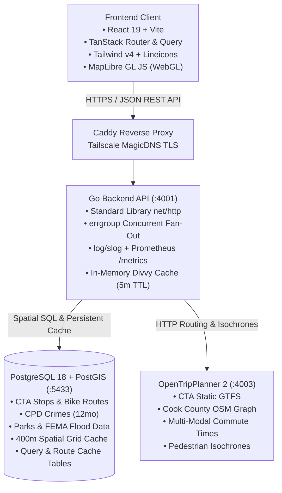
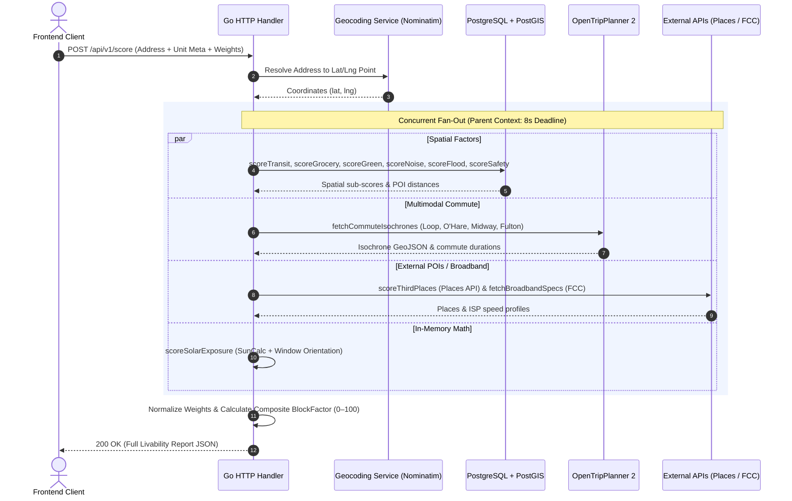

# BlockFactor: Architecture & Technical Specification

**Version:** 0.1 (In Progress — being designed collaboratively)
**Status:** Draft
**See also:** [PRD.md](./PRD.md) for product requirements and scoring logic.

---

## 1. Deployment Phases

### Phase 1 — Home Server (Current / Development)

BlockFactor is initially self-hosted on a personal home server for active development and personal use. The developer is the first real user with a concrete deadline: **evaluating Chicago neighborhoods ahead of a move from Pilsen, targeting May 2027.**

**Host Hardware:**
- **Device:** Beelink SEi12 Mini PC
- **OS:** Ubuntu 22.04.5 LTS (Jammy Jellyfish)
- **CPU:** Intel Core i7-12650H (10 cores / 16 threads, up to 4.7 GHz)
- **RAM:** 32 GB total — ~24 GB currently free across co-located services
- **Co-located Services:** Plex, Arr stack (Sonarr, Radarr, Bazarr), Usenet clients, Home Assistant, n8n, monitoring stack (Prometheus, Grafana, Loki)

**Dedicated Storage for BlockFactor:**
- A dedicated **M.2 NVMe SSD in a Sabrent USB-C enclosure** is provisioned as a dedicated mount for BlockFactor's persistent data volumes: PostGIS data, OTP2 graph files, and OSM extracts.
- Rationale: `/media/disk1` (main array, 704GB free) and `/media/disk2` (17TB array, critically full at 100%) are co-located with media. A dedicated SSD avoids I/O contention and keeps BlockFactor's data isolated and easy to manage.
- **Status (provisioned 2026-08-22):** Partitioned as GPT with a single partition, formatted `ext4` (label `external-ssd-enc` — truncated from `external-ssd-enclosure` due to ext4's 16-character label limit), and mounted at `/mnt/external-ssd-enclosure` (476.9 GB, owned by the `kingsley-swizzin` user). Persisted across reboots via a UUID-based `/etc/fstab` entry (`defaults,noatime`).
- ⚠️ Actual capacity is **512 GB-class (476.9 GB usable)**, smaller than the ~1TB originally estimated — worth keeping in mind for OSM extract + PostGIS + OTP2 graph capacity planning.

**Key Constraints:**
- OTP2 JVM heap capped at ~5 GB to avoid starving co-located services.
- Aggressive caching is a **first-class requirement**, not a future optimization.
- All services run under Docker Compose — no Kubernetes overhead.
- Development environment only. No production hardening required yet.

**CI/CD:**
- GitHub Actions with a **self-hosted runner** on the home server.
- PRs trigger lint, test, and build pipelines on local hardware (zero cost).

---

### Phase 2 — Cloud Deployment (Post-Polish / Monetization)

Once the application reaches a quality threshold validated through personal use, BlockFactor migrates to cloud infrastructure with monetization activated.

**Target Stack:** Hetzner (compute) + Cloudflare (CDN / DNS / Tunnels)
- Hetzner CX/CAX VMs (~$8–15/month) offer substantially better price/performance than AWS EC2.
- Cloudflare free tier covers DNS, CDN, and DDoS protection. Cloudflare Tunnels can bridge Phase 1's home server to the public internet without port forwarding.
- AWS remains an option for specific managed services (e.g., RDS) but is not the primary compute target.

**CI/CD:**
- Same GitHub Actions pipelines, retargeted to Hetzner via SSH deploy or container registry push.
- Explore Dagger for pipeline portability as a learning opportunity.

---

## 2. Home Server Environment Profile

> Captured via automated server inventory on 2026-08-21. Informs integration decisions.

### 2.1 Reverse Proxy

- **Caddy** is the sole active reverse proxy (`/etc/caddy/Caddyfile`), running since boot.
- Nginx is installed but inactive. Traefik is not present.
- TLS is handled automatically by **Tailscale MagicDNS** — Caddy provisions certs for `*.han-puffin.ts.net` with zero manual management.
- Primary local access domain: `kingsley-home-server.han-puffin.ts.net`
- **Integration pattern for BlockFactor:** Add a `handle_path /blockfactor/*` block in the Caddyfile (or a dedicated port-based virtual host), proxying to `localhost:<port>`. This is the existing pattern for all services.

### 2.2 Existing Infrastructure BlockFactor Can Leverage

| Resource | Location | Relevance |
|---|---|---|
| **Redis** | `localhost:6379` (host-level) | Available for short-TTL in-memory caching (Divvy GBFS, OTP2 results). No sidecar needed. |
| **PostgreSQL 15** | Internal (Mealie) | Do NOT share — spin a dedicated PostGIS container. |
| **PostgreSQL 16** | Internal (n8n) | Do NOT share — spin a dedicated PostGIS container. |
| **Portainer** | `:9443` | Docker management UI — BlockFactor can be managed here or via standalone Compose. |

### 2.3 Port Allocation

Ports in the 4000–4999 range are unoccupied and reserved for BlockFactor services:

| Service | Host Port |
|---|---|
| Go API | `4001` |
| Frontend (Vite dev server) | `4002` |
| OTP2 | `4003` |
| PostgreSQL + PostGIS | `5433` (avoids conflict with host-level `:5432`) |

### 2.4 Compose Project Location

Following the existing manual compose pattern (e.g., `strava-stats`, `readmeabook`):
```
/home/kingsley-swizzin/blockfactor/
├── docker-compose.yml
├── .env
└── data/               # symlink or bind mount → /mnt/external-ssd-enclosure
```

---

## 3. High-Level System Topology



---

## 4. Backend Architecture & Request Orchestration

### 4.1 Core Language & Contracts
* **Language:** **Go**
  * High-performance compiled binary with minimal memory footprint on shared home server hardware.
  * Native goroutine scheduling and channel primitives for concurrent I/O fan-out.
* **Type Contracts:** **OpenAPI 3.0 / REST**
  * Single source-of-truth API specification.
  * Generates strict types for Go backend (`oapi-codegen`) and TypeScript frontend (`openapi-typescript`).
  * Avoids gRPC gateway complexity while maintaining end-to-end type safety.

### 4.2 Concurrency & Pipeline Lifecycle (`errgroup`)
Rather than a generic worker pool, address evaluation uses structured concurrency with Go's `golang.org/x/sync/errgroup`:



### 4.3 Geocoding Strategy
* **Phase 1 (Development):** Public Nominatim API (`nominatim.openstreetmap.org`) with structured query formatting for low-volume development testing.
* **Phase 2 (Production / Pre-Launch):**
  * **Self-Hosted Nominatim (PostGIS):** Ingests Illinois OSM extract for accurate, ToS-compliant address resolution and building polygon snapping.
  * **Photon (Elasticsearch/Lucene, Optional):** Lightweight search index (<2GB RAM) for low-latency (<20ms) typeahead address search in the UI input bar.

### 4.4 Idiomatic Go Package Layout
The Go backend follows a cohesive, domain-layered package structure that avoids fragmentation while maintaining testability:

```text
services/api/
├── cmd/
│   ├── server/main.go          # HTTP API entry point (net/http ServeMux wiring)
│   └── seed/main.go            # Open dataset ingestion CLI (CTA, CPD Crimes, Parks)
├── internal/
│   ├── api/                    # HTTP handlers, middleware, request validation
│   ├── scoring/                # Composite scoring orchestrator & factor math
│   │   ├── engine.go           # errgroup fan-out & weight normalization
│   │   ├── factor_transit.go   # S_transit calculation
│   │   ├── factor_grocery.go   # S_grocery calculation
│   │   ├── factor_third_places.go # S_third_place calculation
│   │   ├── factor_green.go     # S_green calculation
│   │   ├── factor_noise.go     # S_noise calculation
│   │   ├── factor_flood.go     # S_flood calculation
│   │   ├── factor_safety.go    # S_safety percentile calculation
│   │   └── factor_solar.go     # S_solar deterministic math
│   ├── spatial/                # PostGIS queries (ST_DWithin, GIST indexes, grid cells)
│   ├── clients/                # Outbound HTTP clients (Nominatim, OTP2, Places, FCC)
│   └── cache/                  # Postgres UNLOGGED cache + in-memory sync.Map
├── go.mod
└── go.sum
```

---

## 5. Spatial Database & Caching Architecture

### 5.1 Database Engine & Image
* **Engine:** **PostgreSQL 18 + PostGIS** extension.
* **Docker Context:** Runs as a dedicated container (`blockfactor-db`) isolated from any existing host database.
* **Volume Mount:** Persisted to the dedicated NVMe SSD mount point (`/mnt/external-ssd-enclosure/blockfactor/pgdata`).

### 5.2 Spatial Coordinate Standard & Types
* **Standard Representation:** `geography(Point, 4326)` (WGS84 GPS latitude and longitude).
* **Rationale:** Direct GPS compatibility; native meter-based radial queries (`ST_DWithin`) without reprojection overhead.

### 5.3 Spatial Indexing Strategy
* **Index Type:** `GIST` indexes on all location geometry columns (`cta_stops`, `cpd_crimes`, `parks`, `bike_routes`).
* **Performance:** Executes radial queries across 300k+ spatial records in < 5 ms.

### 5.4 Two-Tier Caching Architecture (100% Self-Contained)
To avoid dependencies on external host Redis instances, caching is partitioned across two self-contained tiers:

1. **In-Process Go Cache (Volatile Tier):**
   * Stored in-memory in Go (`sync.Map` / bounded LRU with TTL).
   * Used for high-frequency, ultra-short data: **Divvy GBFS dock & e-bike availability** (5-minute TTL).
2. **PostgreSQL Cache Tables (Persistent Tier):**
   * Stored in `UNLOGGED` tables with an indexed `expires_at` column.
   * **Google Places 400m Grid Cache:** 30-day TTL.
   * **FCC Broadband Address Cache:** Bi-annual refresh.
   * **OTP2 Commute Route Durations:** 7-day TTL.

---

## 6. Transit & Isochrone Engine (OpenTripPlanner 2.x)

### 6.1 Role & Capabilities
* **Engine:** OpenTripPlanner 2.x running in a dedicated Docker container (`blockfactor-otp`).
* **Inputs:**
  * CTA Static GTFS Schedule archive (`chicago-gtfs.zip`).
  * Cook County OpenStreetMap extract (`illinois.osm.pbf`).
* **Outputs:**
  * **Door-to-door transit commute durations** (walking + waiting + riding + transfers) to benchmark employment centers (The Loop, O'Hare, Midway, Fulton Market).
  * **Pedestrian & transit reach isochrone polygons** (e.g. 15-min and 30-min travel boundaries) streamed to MapLibre GL JS as GeoJSON.

### 6.2 Resource Controls & Persistence
* **JVM Heap Limit:** Strictly capped at `-Xmx5G` to prevent memory contention with co-located media and automation stacks.
* **Graph Persistence:** The graph is pre-compiled once (`otp --build data/`) and saved as `graph.obj` on the dedicated NVMe SSD (`/mnt/external-ssd-enclosure/blockfactor/otp-data/graph.obj`). On restarts, OTP2 boots in < 15 seconds by loading the pre-compiled graph directly into RAM.

---

## 7. Frontend Client & Visualization Architecture

### 7.1 Framework & Core Tooling
* **Build Tool & Framework:** **React 19 + Vite** (Single Page Application).
* **Routing:** **TanStack Router**
  * Strict type-safe route definitions.
  * **Search Param Serialization:** Address, unit orientation (e.g. facing, floor), and custom factor weights (0–100%) are continuously synchronized to the URL query string (`/report?address=...&w_transit=35&w_grocery=25&facing=S`).
  * Enables zero-friction link sharing and browser bookmarking that preserves exact report state.
* **Server State & Caching:** **TanStack Query**
  * Automatic request deduplication, background prefetching, and client-side caching.
* **OpenAPI Client:** Generated TypeScript API client (`openapi-typescript` + `openapi-fetch`) typed directly from backend OpenAPI specs.

### 7.2 Component Library & Design System
To enforce an analytical, high-density tool aesthetic and avoid generic AI "vibe-coded" tropes:
* **Component Primitives:** **`shadcn/ui` (Radix UI)** copied directly into `packages/web/src/components/ui/` with custom, sharp design tokens.
* **Styling Engine:** **Tailwind CSS v4** with a strict design token scale:
  * **Geometry:** Sharp, disciplined border radii (`rounded-sm` / `rounded-md`—no bubbly pill shapes).
  * **Palette:** Neutral Slate/Zinc base (`#09090b` / `#fafafa`) with zero purple/violet radial gradients.
  * **Transit Branding:** Authentic CTA Line colors for station badges (Red `#c60c30`, Blue `#00a1de`, Brown `#62361b`, Green `#009b3a`, Pink `#e27ea6`, Orange `#f9461c`, Purple `#522398`, Yellow `#f9e300`).
  * **Score Indicators:** Emerald (≥ 85), Lime (70–84), Amber (50–69), Rose (< 50).
* **Iconography:** **Lineicons** (14–16px, 1.5px stroke). Strictly no Lucide over-use and zero emoji slop in headers/cards.
* **Typography:** **Inter / Geist** for body text; **Geist Mono** for all coordinates, distances (`0.28 mi`), commute times (`14 min`), and numeric scores.

### 7.3 Screen Layout & Workspace Architecture
The primary interface is a **Split-Screen Location Intelligence Workspace**:
* **Left Panel (Scored Analytics & Controls — Scrollable):**
  * **Composite Score Hero Card:** Radial score ring (0–100) + neighborhood archetype descriptor.
  * **Weight Customization Drawer:** Reactive slider tray with dynamic normalization and preset chips (Car-Free, Cyclist, Remote Worker).
  * **Factor Breakdown Accordions:** 8 dense metric cards with distance pills and sub-scores.
  * **Native Affiliate Drawer:** Contextually triggered cards (ISP broadband speed check, Lemonade quote, Dolly movers).
* **Right Panel (WebGL Map — Fixed / Full Bleed):**
  * Full-screen GPU-accelerated **MapLibre GL JS** canvas.
  * Layer toggles: CTA rail lines, protected bike corridors, parks, crime heat contours, and POI clusters.
  * Interactive 15-minute walk and 30-minute transit reach isochrone polygons.
* **Bottom Comparison Dock (Collapsible):**
  * Sticky drawer allowing users to pin and compare up to 3 addresses side-by-side.

### 7.4 Map Engine & WebGL Vector Rendering
* **Map Visualizer:** **MapLibre GL JS**
* **Vector Basemap Tiles:** CartoCDN / OpenFreeMap vector styles ($0 licensing fees, GPU accelerated).

### 7.5 Link Sharing & Social Previews (Phasing)
* **Phase 1 (Home Server / Personal Use):** Client-side URL state via TanStack Router allows immediate link sharing with identical visual configuration.
* **Phase 2 (Public Launch):** A lightweight Go route handler (`GET /share/:report_id`) injects dynamic OpenGraph meta cards (title, summary score, static preview map snapshot) for iMessage/Slack/Twitter previews.

---

## 8. Database Migrations (`goose`)

### 8.1 Tooling & Workflow
* **Migration Engine:** **`goose`**
* **Migration Format:** Plain `.sql` files with standard `-- +goose Up` and `-- +goose Down` annotations located in `/db/migrations/`.
* **Execution Options:**
  * Standalone CLI for local schema management: `goose -dir db/migrations postgres "$DB_URL" up`.
  * Embedded migration runner: Can be embedded into the Go server binary via `goose.Up(db, "migrations")` to automatically migrate dev and CI databases on container startup.

---

## 9. Monorepo Orchestration & Developer Experience

### 9.1 Root `Makefile` Architecture
To ensure **100% parity between local development and GitHub Actions CI pipelines**, all high-level developer tasks and CI validation steps are driven via a root `Makefile`:

```makefile
.PHONY: dev build test lint migrate-up seed generate

# Start full local development stack (DB, OTP2, Go API with hot-reload, Vite)
dev:
	docker compose up -d db otp
	@echo "Starting Go API (Air) and Vite Frontend..."
	# runs concurrently via air and pnpm dev

# Run all unit and integration tests
test:
	go test -v ./services/api/...
	cd packages/web && pnpm test

# Run linters across Go and TypeScript
lint:
	golangci-lint run ./services/api/...
	cd packages/web && pnpm lint

# Run database migrations
migrate-up:
	goose -dir db/migrations postgres "$$DATABASE_URL" up

# Ingest and seed Chicago base datasets
seed:
	go run ./services/api/cmd/seed/main.go

# Regenerate OpenAPI contracts and client SDKs
generate:
	oapi-codegen -config api/openapi.cfg.yaml docs/openapi.yaml
	cd packages/web && pnpm generate-api
```

### 9.2 CI/CD Parity
* In GitHub Actions (self-hosted runner or GitHub-hosted), CI jobs simply invoke the Makefile targets (`make lint`, `make test`, `make generate-check`).
* Eliminates configuration drift between local developer machines and CI pipelines.

---

## 10. Observability & Monitoring Stack Integration

Because the home server already operates a production-grade monitoring stack (**Prometheus, Grafana, Loki, Promtail**), BlockFactor hooks directly into this infrastructure:

### 10.1 Structured Logging (`log/slog` → Promtail → Loki)
* Standard library **`log/slog`** with JSON formatting (`slog.NewJSONHandler(os.Stdout, ...)`).
* Structured fields: `trace_id`, `address`, `duration_ms`, `factor`, `cache_hit`, `status`.
* Promtail scrapes container stdout logs directly into Loki for fast querying and debugging in Grafana dashboards.

### 10.2 Metrics Collection (`/metrics` → Prometheus)
* Exposes a standard **`/metrics`** endpoint in the Go backend using `prometheus/client_golang`.
* **Key Custom Metrics:**
  * `blockfactor_score_request_duration_seconds` (Histogram by address hash / status)
  * `blockfactor_factor_duration_seconds` (Histogram partitioned by factor: `transit`, `grocery`, `safety`, `otp`, etc.)
  * `blockfactor_cache_hits_total` / `blockfactor_cache_misses_total` (Counter by cache domain: `places`, `otp`, `fcc`, `divvy`)
  * `blockfactor_external_api_calls_total` (Counter for Google Places and FCC API invocations to track quota consumption)

---

## 11. Data Ingestion Pipeline (`cmd/seed`)

### 11.1 Design & Execution Model
Open city datasets are ingested via a dedicated, standalone Go CLI tool (`services/api/cmd/seed/main.go`). This keeps the HTTP API server completely stateless and avoids resource contention during live user requests:

```bash
# Ingest all Chicago open datasets into PostGIS
make seed

# Or run specific dataset imports with flags
go run ./services/api/cmd/seed/main.go --dataset=cta
go run ./services/api/cmd/seed/main.go --dataset=crimes --limit=10000
go run ./services/api/cmd/seed/main.go --dataset=parks,bike_routes
```

### 11.2 Ingested Datasets & Sync Strategy

| Dataset | Provider / Source | Ingestion Mechanism | Production Sync Cadence |
|---|---|---|---|
| **CTA 'L' Stops & Lines** | Chicago Data Portal (SODA API) | GeoJSON stream → `cta_stops` table | Monthly |
| **CTA GTFS Schedules** | Chicago Transit Authority | Archive download → OTP2 graph compile | Quarterly |
| **Protected Bike Routes** | Chicago Data Portal (SODA API) | Linestring GeoJSON → `bike_routes` table | Quarterly |
| **Public Parks & Facilities** | Chicago Data Portal + OSM | Polygon GeoJSON → `parks` table | Quarterly |
| **CPD Crimes (Trailing 12mo)** | Chicago Data Portal (SODA API) | Filtered SODA query (`$where=date > ...`) → `cpd_crimes` | Monthly |
| **FEMA Flood Zones & 311s** | FEMA NFHL + City 311 SODA | Polygon shapefiles + 311 sewer incidents | Semi-annual |

### 11.3 Production Automation (Phase 1)
On the home server, a lightweight systemd timer or monthly cron job invokes `make seed` during off-peak hours (e.g. 3:00 AM on the 1st of each month).

---

## 12. Architecture Decision Log

| # | Topic | Decision | Rationale | Status |
|---|---|---|---|---|
| 1 | Backend Language | **Go** | Concurrency primitives, low memory footprint, single binary deployment. | ✅ Resolved |
| 2 | Type Contracts | **OpenAPI Spec + Codegen** | Cross-stack type safety without gRPC gateway overhead. | ✅ Resolved |
| 3 | Concurrency Model | **`errgroup` Fan-Out + Semaphores** | Structured concurrency with 8s deadline & graceful factor degradation. | ✅ Resolved |
| 4 | Geocoding Engine | **Public Nominatim (Dev) → Self-Hosted Nominatim + Photon (Prod)** | ToS compliance, high accuracy, and fast typeahead. | ✅ Resolved |
| 5 | Database Engine | **PostgreSQL 18 + PostGIS** | Standard spatial engine, native GIS math, and GIST indexing. | ✅ Resolved |
| 6 | Spatial Coordinate Standard | **WGS84 (SRID 4326) / `geography`** | Direct GPS compatibility; native meter-based radial queries without reprojection bugs. | ✅ Resolved |
| 7 | Caching Architecture | **Self-Contained (PostgreSQL UNLOGGED + Go Memory Cache)** | Zero dependency on host Redis; $0 cost, no port conflicts. | ✅ Resolved |
| 8 | Transit Engine | **OpenTripPlanner 2.x (Docker, capped at 5GB JVM)** | Gold standard for transit scheduling, transfers, and native GeoJSON isochrones. | ✅ Resolved |
| 9 | Frontend Stack | **React + Vite + TanStack (Router/Query)** | Lightweight SPA, zero Node server runtime, native WebGL map support. | ✅ Resolved |
| 10 | Map Engine | **MapLibre GL JS** | Open-source WebGL vector map rendering with $0 tile costs. | ✅ Resolved |
| 11 | URL State & Link Sharing | **TanStack Router Search Params (Phase 1) + Go OG Previews (Phase 2)** | Deep-linkable custom weight presets now, social cards on public launch. | ✅ Resolved |
| 12 | Reverse Proxy | **Caddy (`/etc/caddy/Caddyfile`)** | Tailscale MagicDNS TLS auto-managed; path-based routing. | ✅ Resolved |
| 13 | Server Network Ingress | **Tailscale (Dev) → Cloudflare Tunnel (Prod)** | Zero-config private access now, secure public edge later. | ✅ Resolved |
| 14 | DB Migration Tooling | **`goose` (Plain SQL migrations)** | Single SQL format with Up/Down, embeddable in Go binary or CLI. | ✅ Resolved |
| 15 | Monorepo Orchestration | **Root `Makefile`** | Zero installation prerequisites; strict 1:1 parity between local dev and CI. | ✅ Resolved |
| 16 | HTTP Router | **Standard Library `net/http` (Go 1.22+)** | Zero third-party router dependencies; clean method-based routing patterns. | ✅ Resolved |
| 17 | Observability & Logging | **`log/slog` (JSON) + Prometheus `/metrics`** | Hooks directly into existing host Loki & Prometheus monitoring stack. | ✅ Resolved |
| 18 | Compose Topology | **Single `docker-compose.yml` with Profiles (`profiles: ["transit"]`)** | Unifies networking; decouples OTP2 build/start lifecycle from dev app restarts. | ✅ Resolved |
| 19 | Go Internal Package Layout | **Domain-Layered (`internal/scoring`, `internal/spatial`, `internal/clients`)** | Idiomatic Go; groups by responsibility and avoids package fragmentation or circular dependencies. | ✅ Resolved |
| 20 | Data Ingestion Pipeline | **Standalone CLI (`cmd/seed/main.go` + `make seed`)** | Decoupled from API runtime; testable, flag-selectable, and easily scheduled via cron. | ✅ Resolved |

